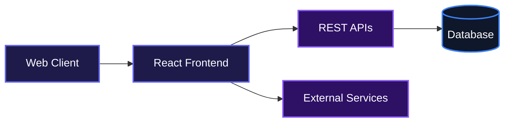
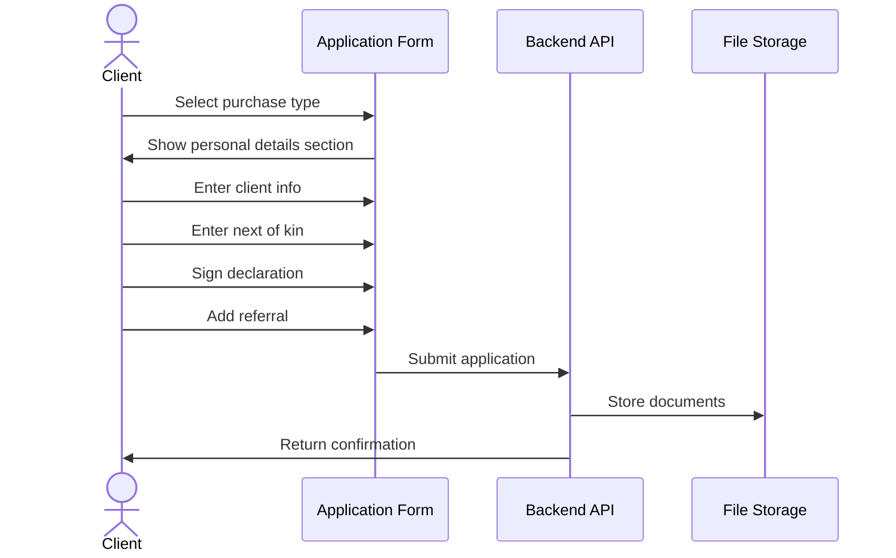
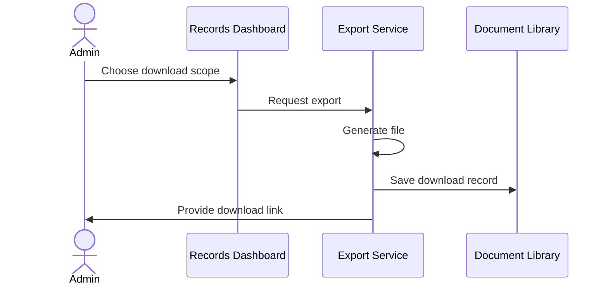
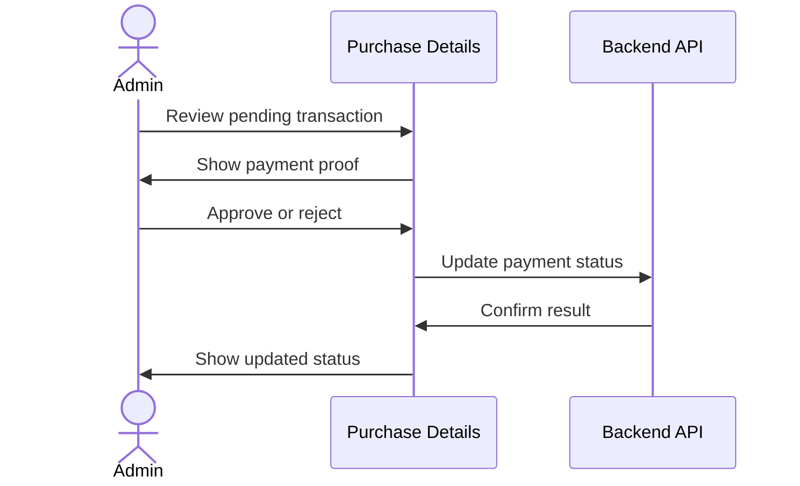

# Pineleaf Client Management System

## Overview

Pineleaf helps real estate teams manage land purchase applications from start to finish. Clients fill out a guided multi-step form, and administrators get a centralized dashboard to review, search, filter, edit, and export records. It replaces scattered spreadsheets and manual tracking with one clean system that handles everything from applicant details to property assignments, payment verification, and document generation.

## Features

- **Multi-step application form**: Clients choose between individual or club/association purchases and complete a guided four-section form with validation, dynamic country and state selection, digital signature capture, and referral details.

- **Role-based admin dashboard**: Authenticated admins land on an overview with live statistics, then navigate through records, properties, users, purchases, refunds, subscriptions, and flagged accounts.

- **Property and inventory management**: Create, edit, view, and toggle online/offline status for estate properties. Each property shows its record count and assigned entries.

- **Barrister property assignments**: Assign one or more properties to barristers, enforce one-barrister-per-property rules, and view all entries tied to a barrister.

- **Payment verification workflow**: Review purchase applications and interest indications, inspect uploaded proof of payment, and approve or reject transactions with optional admin notes.

- **Refund processing**: View refund requests, inspect bank details, and settle or reject claims with a recorded note.

- **Data export and document library**: Export single records or filtered batches as PDF or CSV, browse the generated document library, and submit barrister feedback against exported batches.

- **User verification**: Review registered users, download statements of account, and verify or reject applicants with an approved monthly revenue figure.

- **Flagged account management**: Review security alerts, inspect failed login or verification attempts, and resolve flags with optional re-enabling of the user.

### Multi-step Application Submission

### Admin Export and Download Flow

### Payment Verification

## Usage

### Client Application Submission

From the home page, applicants choose their purchase category:

1. **Individual**: For personal land investment.
2. **Club / Association**: For cooperative or group purchases.

The form is split into four sections:

1. **Section 1: Client Details**
   - Upload a profile photo.
   - Enter name, gender, marital status, and address.
   - Select country of residence and state of origin from searchable dropdowns.
   - For clubs, add registered members.

2. **Section 2: Next of Kin / Representative**
   - Capture the name, relationship or role, phone, and email of the contact person.

3. **Section 3: Client Declaration**
   - Enter land price, number of plots, property name, plot numbers, and branch.
   - Sign digitally on the canvas.
   - Pick a declaration date.

4. **Section 4: Referral**
   - Add the referral name and mobile number.
   - Submit the application and view the success screen.

### Administrator Dashboard

1. **Log in** at `/login` with your username and password.
2. **Dashboard overview** at `/dashboard/overview` shows live counts for applications, properties, branches, barristers, and downloads.
3. **Manage records** at `/dashboard/records` to search, filter by branch, view details, edit, or delete entries.
4. **Export data** from the records page using the Download button, choosing either to continue from the last download or export all records, then selecting PDF or CSV.
5. **View applications** by clicking the view action on any record row to see full applicant details and add internal notes.
6. **Manage properties** at `/dashboard/properties` to toggle online/offline status and inspect entries per property.
7. **Manage barristers** under Settings to assign properties and view their linked entries.
8. **Process purchases, refunds, and subscriptions** from their respective sidebar sections.
9. **Verify users** from `/dashboard/manage/users` to approve salaries and download account statements.
10. **Handle flagged accounts** at `/dashboard/manage/flagged-accounts` to resolve security alerts.

## Technologies Used

| Category | Technology | Description |
| :------- | :--------- | :---------- |
| Language | [TypeScript](https://www.typescriptlang.org/) | Typed JavaScript for safer code. |
| Framework | [React](https://react.dev/) | Component-based UI library. |
| Build Tool | [Vite](https://vitejs.dev/) | Fast modern frontend tooling. |
| Styling | [Tailwind CSS](https://tailwindcss.com/) | Utility-first CSS framework. |
| State Management | [TanStack Query](https://tanstack.com/query/latest) | Server-state caching and mutations. |
| Forms | [Formik](https://formik.org/) | Form state and handling. |
| Validation | [Yup](https://github.com/jquense/yup) | Schema-based form validation. |
| Routing | [React Router](https://reactrouter.com/) | Declarative client-side routing. |
| HTTP Client | [Axios](https://axios-http.com/) | Promise-based API requests. |
| Notifications | [Sonner](https://sonner.emilkowal.ski/) | Toast notifications. |
| Date Handling | [date-fns](https://date-fns.org/) and [React Datepicker](https://reactdatepicker.com/) | Date formatting and picker components. |
| Phone Validation | [libphonenumber-js](https://gitlab.com/catamphetamine/libphonenumber-js) | International phone validation. |
| PDF Export | [jsPDF](https://jspdf.org/) and [jspdf-autotable](https://www.npmjs.com/package/jspdf-autotable) | Client-side PDF generation. |
| Animations | [Framer Motion](https://www.framer.com/motion/) | Page transitions and UI animations. |

## Badges

